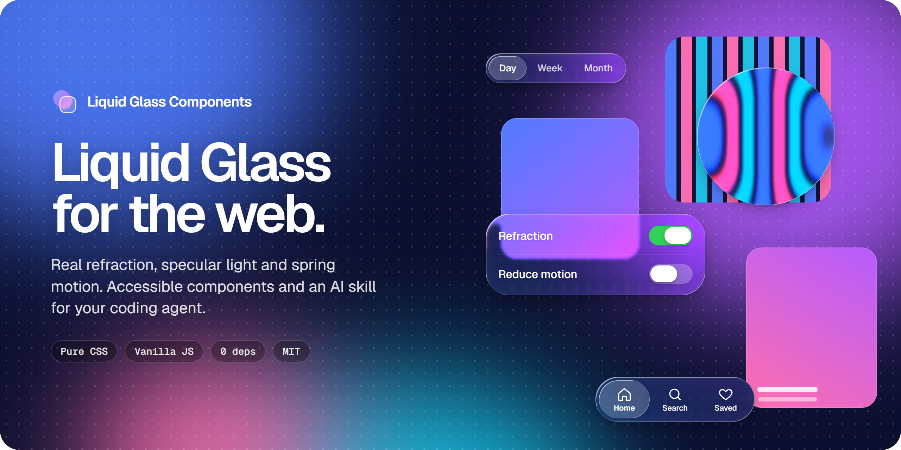

<div align="center">

<a href="https://jcm-developer.github.io/liquid-glass-components/">
  
</a>

<h3>Apple's Liquid Glass material for the web.</h3>

<p>Real refraction, specular light and spring motion in copy-paste CSS components,<br>plus an AI skill that teaches your coding agent to use them right.</p>

[](https://jcm-developer.github.io/liquid-glass-components/)
[](LICENSE)
[](docs/operations.md#versioning)
[](#components)
[](#quick-start)
[](.github/workflows/ci.yml)

**[Live demo](https://jcm-developer.github.io/liquid-glass-components/)** ·
[Components](#components) ·
[Quick start](#quick-start) ·
[AI skill](#install-as-an-ai-skill) ·
[Playground](https://jcm-developer.github.io/liquid-glass-components/#playground)

</div>

<br>

## Why Liquid Glass Components

Most "glassmorphism" on the web is a blurred, semi-transparent box. Liquid Glass is a
different material: it **bends** what is behind it at the edges, catches light on both sides
of the bezel and reacts to touch. This project reproduces that material with web standards
only, and keeps every component usable when the effect is not available.

<table>
  <tr>
    <td width="33%" valign="top">
      <h4>Real refraction</h4>
      An SVG displacement map generated from each element's own shape bends the backdrop at
      the bezel like a lens, with a faint chromatic fringe.
    </td>
    <td width="33%" valign="top">
      <h4>The actual material</h4>
      Low frost, two specular rims and a pointer-reactive sheen, instead of a heavy frosted
      blur that hides the content.
    </td>
    <td width="33%" valign="top">
      <h4>Fluid interaction</h4>
      Pressed controls swell, switch and slider thumbs turn into lenses, selections slide and
      stretch on native CSS <code>linear()</code> springs.
    </td>
  </tr>
  <tr>
    <td valign="top">
      <h4>Accessible by default</h4>
      Reduced transparency, increased contrast, reduced motion and forced colours fallbacks
      in every component, plus WCAG AA text.
    </td>
    <td valign="top">
      <h4>Zero dependencies</h4>
      Plain CSS and one optional vanilla JavaScript file. No framework, no bundler, no build
      step. Copy, paste, ship.
    </td>
    <td valign="top">
      <h4>AI-ready</h4>
      Installs as a skill for Claude Code, Cursor, Copilot, Codex, Gemini CLI and Windsurf,
      so your agent writes glass that follows the rules.
    </td>
  </tr>
</table>

## Components

Every component lives on the chrome layer: the bars, controls and overlays that float above
content. Try them all on the [live demo](https://jcm-developer.github.io/liquid-glass-components/#components).

| Component | File | Highlights |
|---|---|---|
| Surface | `glass-surface.css` | Base material for custom glass elements |
| Button | `glass-button.css` | Regular, prominent, icon, small and plain variants |
| Card | `glass-card.css` | Floating panel for players, widgets and inspectors |
| Tab Bar | `glass-tab-bar.css` | Icon and label tabs with a sliding indicator |
| Toolbar | `glass-toolbar.css` | Floating tool pill and fixed website header |
| Segmented Control | `glass-segmented.css` | Selection that slides and stretches |
| Toggle | `glass-toggle.css` | Thumb that becomes a lens while pressed |
| Slider | `glass-slider.css` | Capsule thumb that becomes a lens while dragged |
| Search Field | `glass-search.css` | Pill that springs wider on focus |
| Navigation Bar | `glass-nav-bar.css` | Glass button groups, a large title that collapses on scroll |
| Modal / Sheet | `glass-modal.css` | Native `<dialog>`, centred or bottom sheet |
| Toast | `glass-toast.css` | Springs in from the bottom or top edge |
| Popover | `glass-popover.css` | Contextual menu with shortcuts and dividers |
| Sidebar | `glass-sidebar.css` | Navigation with a sliding current-page indicator |
| Dock | `glass-dock.css` | Proximity magnification |

## Quick start

1. Copy `skills/liquid-glass/snippets/tokens.css` and the component files you need.
2. Optionally copy `liquid-glass.js` for refraction and behaviours.
3. Use the markup from the docblock at the top of each CSS file.

```html
<link rel="stylesheet" href="tokens.css">
<link rel="stylesheet" href="glass-tab-bar.css">
<script src="liquid-glass.js" defer></script>

<nav class="glass-tabs" role="tablist" aria-label="Main" data-refract>
  <button class="glass-tabs__tab" type="button" role="tab" aria-selected="true">
    <span class="glass-tabs__label">Home</span>
  </button>
  <button class="glass-tabs__tab" type="button" role="tab" aria-selected="false">
    <span class="glass-tabs__label">Search</span>
  </button>
</nav>
```

`data-refract` opts an element into refraction. Glass needs something to look through: place
it over photos, video, wallpapers or scrolling content.

> [!TIP]
> Glass belongs on the chrome layer only, and never on top of other glass. Controls inside a
> glass surface are flat fills. The skill enforces both rules for your agent.

## Install as an AI skill

### Universal prompt

Copy this prompt into any AI coding agent:

```
Install the "liquid-glass" skill from https://github.com/jcm-developer/liquid-glass-components and use it in this project.

1. Detect which agent/environment you are (Claude Code, Cursor, Codex, Gemini CLI, Windsurf, Copilot) and choose the corresponding installation method from the repo's README.
2. Copy the `skills/liquid-glass` folder to the appropriate skills/rules location for your agent (project-level unless told otherwise). If your agent uses a proprietary format (.mdc, .instructions.md, AGENTS.md), use the corresponding adapter from the `agents/` folder.
3. Read SKILL.md and the files in `references/` and `snippets/` before writing code.
4. Review the current project stack (framework, styling system, existing tokens) and integrate the skill's tokens without breaking existing styles.
5. Confirm the installation path and give me a 3-line summary of the main rules.
6. Then ask me which component I want to create or restyle first with Liquid Glass.

Always respect: WCAG AA contrast (≥4.5:1), prefers-reduced-transparency fallback, prefers-reduced-motion suppression, no glass on content layer, no glass on glass, min font-weight 500 on glass, at most 3 glass surfaces visible at once on mobile.
```

### By agent

<details>
<summary><strong>Claude Code</strong></summary>

```bash
# Option A: npx skills (recommended)
npx skills add jcm-developer/liquid-glass-components

# Option B: Manual clone
git clone https://github.com/jcm-developer/liquid-glass-components /tmp/lgc
cp -r /tmp/lgc/skills/liquid-glass .claude/skills/
rm -rf /tmp/lgc
```

Skill location: `.claude/skills/liquid-glass/SKILL.md`
</details>

<details>
<summary><strong>Cursor</strong></summary>

```bash
# Install Cursor AI rule
mkdir -p .cursor/rules
cp agents/cursor-rule.mdc .cursor/rules/liquid-glass.mdc

# Or paste the "Any agent" prompt into Cursor Composer
```
</details>

<details>
<summary><strong>GitHub Copilot</strong></summary>

```bash
# Add Copilot instructions
mkdir -p .github/instructions
cp agents/copilot-instructions.md .github/instructions/liquid-glass.instructions.md
```
</details>

<details>
<summary><strong>OpenAI Codex</strong></summary>

```bash
# Configure Codex project skills
cp agents/AGENTS.md ./AGENTS.md
mkdir -p .agents/skills
cp -r skills/liquid-glass .agents/skills/
```
</details>

<details>
<summary><strong>Gemini CLI / Antigravity</strong></summary>

```bash
# Option A: CLI install
gemini skills install https://github.com/jcm-developer/liquid-glass-components

# Option B: Manual copy
mkdir -p .gemini/skills
cp -r skills/liquid-glass .gemini/skills/

# Option C: npx skills
npx skills add jcm-developer/liquid-glass-components
```
</details>

<details>
<summary><strong>Windsurf</strong></summary>

```bash
# Install Windsurf Cascade rule
mkdir -p .windsurf/rules
cp agents/windsurf-rule.md .windsurf/rules/liquid-glass.md
```
</details>

## Design tokens

Every optical parameter is a CSS custom property. Override them globally or on one element:

```css
:root {
  --glass-tint: 0.08;          /* surface fill opacity */
  --glass-rim: 0.6;            /* specular rim intensity, 0 to 1 */
  --glass-blur: 2px;           /* frost while refraction is active */
  --glass-blur-fallback: 8px;  /* frost without refraction */
  --glass-refraction: 48;      /* displacement strength in px */
  --glass-bezel: 22px;         /* width of the curved lens edge */
  --glass-chroma: 0.5;         /* chromatic dispersion, 0 to 1 */
}
```

The [playground](https://jcm-developer.github.io/liquid-glass-components/#playground) on the
live demo exports these values. See [`tokens.css`](skills/liquid-glass/snippets/tokens.css)
for the full set, including the light and dark schemes (`data-glass-scheme`) and every
accessibility override.

## Accessibility

Accessibility is part of each component, not an add-on:

| User preference | What the components do |
|---|---|
| `prefers-reduced-transparency` | Solid, opaque surfaces; refraction off |
| `prefers-contrast: more` | Full-strength rims, no text shadow; refraction off |
| `prefers-reduced-motion` | Springs and animations become instant |
| `forced-colors: active` | System colours; outlines become visible |

Text on glass meets WCAG AA (4.5:1) over typical backdrops; over bright photos and video the
skill adds a dimming layer behind the control to keep it there. Controls default to 44 pixel touch targets
(`--glass-target`), and every
interactive component ships with the ARIA roles and keyboard support from its docblock.

## Browser support

| Feature | Chrome / Edge | Safari | Firefox |
|---|---|---|---|
| Glass material (`backdrop-filter`) | 76+ | 9+ (`-webkit-`) | 103+ |
| Real refraction (`backdrop-filter: url()`) | Yes | Blur fallback | Blur fallback |
| CSS `linear()` springs | 113+ | 17.2+ | 112+ |
| View Transitions (landing only) | 111+ | 18+ | 144+ |

Refraction also stays off on touch devices by default (battery), under reduced transparency,
increased contrast and forced colours.

## Repository structure

```
liquid-glass-components/
├── skills/liquid-glass/   # The skill: SKILL.md, references/, snippets/
├── agents/                # Adapters for Cursor, Copilot, Codex, Windsurf
├── site/                  # Landing page (GitHub Pages)
├── docs/                  # Contributor documentation
├── scripts/               # check-docs.mjs
├── AGENTS.md              # Rules for agents working on this repo
└── CONTRIBUTING.md
```

## Contributing

Contributions are welcome, from bug reports to new components. Start with
[CONTRIBUTING.md](CONTRIBUTING.md); contributor docs live in [`docs/`](docs/):
[code style](docs/code-style.md), [component contract](docs/domains/components.md),
[refraction engine](docs/domains/refraction-engine.md), [operations](docs/operations.md) and
the [decision log](docs/decisions.md).

If this project helps you, a star on GitHub helps other people find it.

## License

[MIT](LICENSE). Free for personal and commercial use.

---

## Legal disclaimer and trademark notice

**Liquid Glass Components** is an independent, community-driven open-source project.

This project is **not** affiliated, associated, authorized, endorsed by, or in any way officially connected with **Apple Inc.**, or any of its subsidiaries or its affiliates. The official Apple website can be found at [apple.com](https://www.apple.com).

The names **Apple**, **Liquid Glass**, **macOS**, **iOS**, **iPadOS**, **watchOS**, **visionOS**, **SF Pro**, and **SF Symbols**, as well as related names, marks, emblems, and images, are registered trademarks or trademarks of Apple Inc. in the United States and/or other countries and regions.

Any reference to Apple's design terminology (including "Liquid Glass") is made solely for descriptive, comparative, and nominative purposes under fair use principles to communicate the aesthetic inspiration and technical intent of these web components. All trademarks and registered trademarks remain the property of their respective holders.
